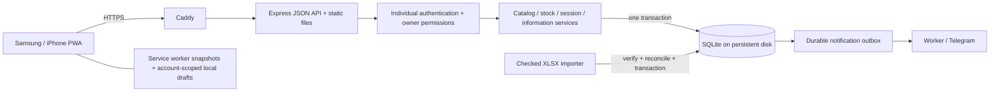

# VARKA architecture

## Implemented modules

For the temporary no-Node-host alternative, see [Google mode](google-mode.md): a separate static PWA uses an origin-pinned Apps Script iframe bridge and the existing workbook as its only authoritative database. It does not mirror data into the SQLite instance described below. The original Node frontend and API remain unchanged.

| Module                                                                | Responsibility                                                                                                                                  |
| --------------------------------------------------------------------- | ----------------------------------------------------------------------------------------------------------------------------------------------- |
| `server/database.js`, `server/varka/schema.js`                        | SQLite connection, WAL, schema initialization; VARKA tables are additive to the earlier starter tables                                          |
| `server/varka/core.js`                                                | Exact decimal arithmetic, validation, canonical request hashing, transactions, idempotent operations                                            |
| `server/varka/import.js`                                              | XLSX parsing, legacy hash verification, compact-envelope expansion, event replay, reference/flag/timestamp reconciliation, transactional import |
| `server/varka/auth.js`                                                | Individual scrypt-hashed access codes, persistent/revocable login sessions, per-email/IP throttling, owner provisioning                         |
| `server/varka/catalog.js`                                             | Bilingual products, categories, units/packaging, activation, zones, history-safe archival                                                       |
| `server/varka/stock.js`                                               | Stock projection, immutable events, movements, revision checks, paginated history, report planning                                              |
| `server/varka/sessions.js`                                            | Frozen checklists, explicit refresh, all-zone counts, atomic catalog/count submissions, completion and correction rules                         |
| `server/varka/information.js`                                         | Versioned reminders, yellow cards, profile names, author snapshots                                                                              |
| `server/varka/notifications.js`                                       | Owner settings, durable delivery worker, explicit retry of failed/ambiguous reports                                                             |
| `server/varka/router.js`                                              | Explicit authenticated `/api/varka` routes; no generic Apps Script RPC execution                                                                |
| `public/varka.js`, `public/locales.js`                                | Mobile views, RU/EN labels, safe DOM rendering, drafts, persisted operation recovery                                                            |
| `public/varka-sw.js`                                                  | Versioned app shell and selected API snapshots; no write caching/replay                                                                         |
| `scripts/import-varka.js`, `scripts/user-add.js`, `scripts/backup.js` | Repeatable operational commands                                                                                                                 |

## Storage and transactions

The `varka_*` tables preserve stable source product IDs and original event IDs. `varka_events` contains the 839 expanded source events, including three legacy location records. Only café-wide events project onto `varka_stock`; zone counts are provenance/components of a café count, not an additional balance ledger. Original workbook rows and hashed envelopes remain in private `varka_legacy_rows` / `varka_batches`. A migration-run fingerprint supports safe replays and prevents replacement of populated inventory.

Quantities/minimums are canonical decimal TEXT values in SQLite. Arithmetic parses them into `BigInt` scaled by 100,000,000; no stock arithmetic uses floating-point `Number`. Native API clients send decimal strings. Maximum supported quantity is 1,000,000,000 with up to eight decimal places; unsupported import precision/range is refused. Unknown balances and unset minimums are SQL NULL, distinct from zero. Units never convert implicitly, except explicitly configured sleeves of 25 pieces. Whole-piece results are enforced.

The stock projection stores the last accepted physical-check timestamp/author, accuracy, manual-low flag, most recent event, and a version. Product versions and stock versions form an item revision. Deliveries/waste do not refresh the physical-check date. A fresh count can clear an estimate/manual flag. Staleness uses each product's check interval; manual low is independent of the automatic threshold.

`operation()` executes replay lookup, validation, all writes, response persistence, and commit under `BEGIN IMMEDIATE`. Operation identity includes the actor, operation kind, and canonical UTF-8 payload hash. The same request returns its stored result; changed requests under the same ID are rejected. Failed validation rolls everything back and does not reserve the operation ID.

An inventory submission can update product activation/zones, append all counts, update balances, close the session, and enqueue reports in one transaction. Every required zone must be present exactly once; snapshot units, packaging, and revisions are checked before accepting totals. Completion distinguishes COMPLETE, COMPLETE_WITH_UNCHANGED, and INCOMPLETE. Kept blanks create no fabricated CHECK entries and do not change freshness.

Session corrections append a revision, never edit source events. HISTORY_ONLY leaves stock unchanged. CURRENT additionally appends a count only if the original actor/unit rules hold and no newer stock movement exists. Both event and correction-history versions are checked.

## Access and recovery

Users have individual emails, display names, owner/staff roles, enabled flags, and salted scrypt code hashes. HttpOnly SameSite=Strict cookies identify hashed-token sessions persisted in SQLite. Production adds Secure and the `__Host-` cookie prefix. Codes are never returned by the API or included in browser pending requests. Provisioning/rotation revokes account sessions. A final provisioned owner cannot be disabled/demoted.

An explicitly labeled development owner is available only outside production and only while no enabled credentialed users exist. `server/index.js` refuses production startup without a provisioned owner; first-start `OWNER_EMAIL`/`APP_PASSWORD` can provision one. Imported profiles deliberately have no copied authentication secrets. Owner access is required for staff management and notification configuration/retry.

Mutations require JSON and a custom same-origin header; mismatched Origin is rejected. No cross-origin API access is configured. A same-origin content security policy blocks inline/external scripts. User text enters the DOM through text nodes, not HTML interpolation.

Count drafts store the original item revision, local count times, zone values, and flags under account/session-specific localStorage keys. A stock or metadata refresh never silently updates a draft's revision. The user explicitly reviews changed stock before keeping an entry, and the server rechecks on submit. Browser storage failures stop submission so a draft is not treated as durably saved.

A pending stock operation is persisted before sending. Editing/submitting additional mutations is blocked while its outcome is unresolved. Retry uses its original ID and exact body, including after reload. Access-code forms deliberately bypass persistent operation bodies, keeping the code only in memory; the server persists only a code fingerprint with the account operation. Credential-rotation ambiguity can be resolved by signing in using the intended new code or provisioning again.

## PWA and offline behavior

The service worker precaches the same-origin shell and uses network-first reads for bootstrap inventory, the first history page, and information. Cached responses are labeled offline; expired-session responses clear snapshots instead of falling back to old authorized data. Login/logout also clears saved API data, and a generation guard prevents a concurrent old read from repopulating it. Account codes and login responses are never cached.

Stock writes require a connection. Already opened sessions can be drafted offline and recovered locally, but no background worker automatically submits counts. Locking revokes server access and clears snapshots; account-scoped drafts remain for deliberate recovery on the same trusted device. These device-local records are not encrypted backups, and browsers may evict them.

The manifest and icons support standalone installation on modern Samsung browsers and iOS Safari home screens. HTTPS is required on phones. The framework-free frontend has no CDN/font/build dependency. Dates display in Europe/Minsk, matching the original workflow. Automated mobile tests currently emulate phone sizes in Chromium, not actual Safari or phone hardware.

## Notifications and deployment

Report planning and outbox insertion occur inside stock transactions. External HTTP calls happen after commit, on a timer, only when credentials and `TELEGRAM_DELIVERY_ENABLED=true` are supplied. Imports never queue historical reports. Reports use standard Telegram text delivery; the Apps Script rich-message implementation is not copied.

The worker claims PENDING as SENDING, records SENT or a definite FAILED result, and leaves network-ambiguous results UNKNOWN. A process restart converts interrupted SENDING rows to UNKNOWN. No automatic uncertain-delivery retry occurs. Owners can explicitly retry after checking the chat and accepting duplicate risk for UNKNOWN outcomes. No notification failure changes committed stock.

Deploy one Node process with a persistent local SQLite volume behind one trusted HTTPS proxy. The Compose image runs as a nonroot user and excludes private data. Publication to a domain is a separate operational step; source/data verification and a local container smoke test do not establish public TLS or real-phone readiness. Use the online backup API and test restoration before final cutover.

The earlier generic starter schema/API remains separate for compatibility. The current interface and `/api/varka` use the VARKA domain; new development should extend that domain rather than write to the old `items` table.
